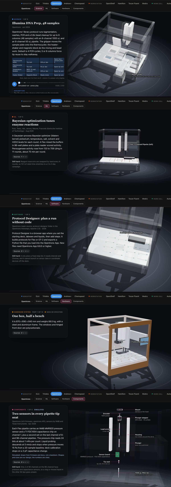
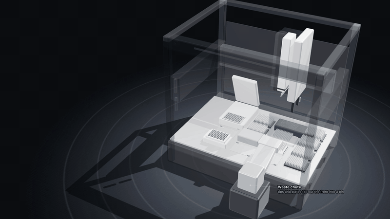
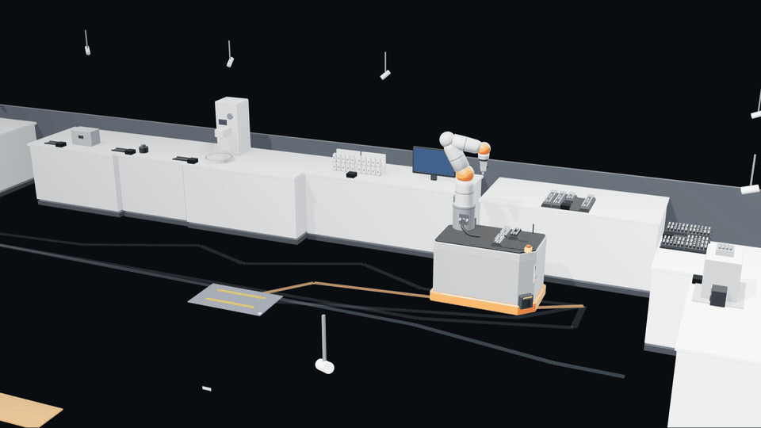
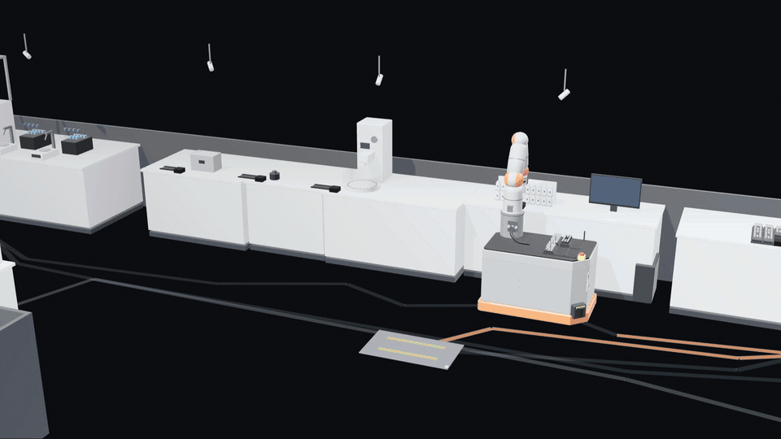
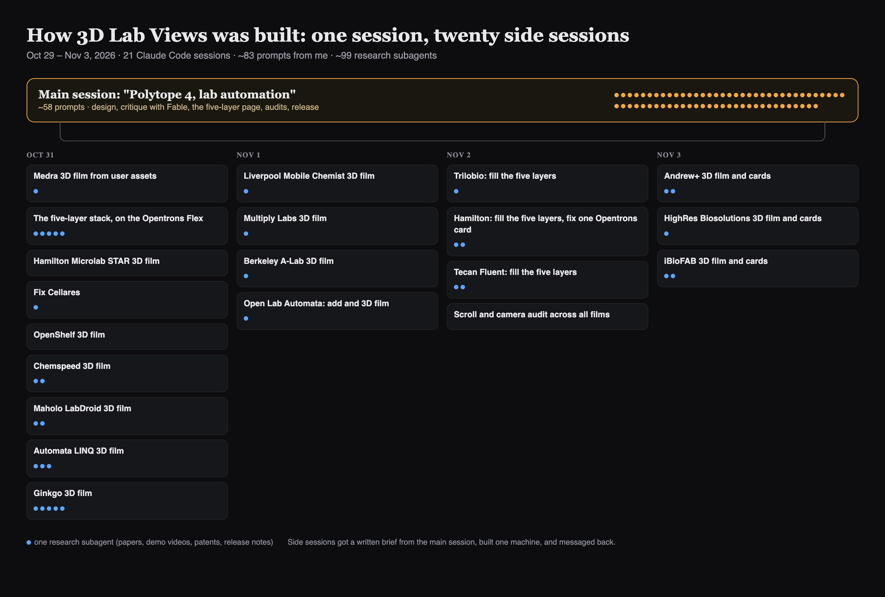

# I gave Claude my X bookmarks. It built 17 lab machines in 3D.

We just hosted our seventh AI for Science hack in SF, [Physical AI for Life Science](https://sfaisciencestudio.substack.com/p/physical-ai-for-life-science-hack). One of the wilder builds was Lab Sentry: a live digital twin of the Opentrons Flex deck, where a camera watches the deck and blocks the run from starting until reality matches the protocol.

That got me curious. If a team can build that in a weekend, what could Claude do if I handed it the lab automation posts sitting in my X bookmarks? So I let it loose. It watched demo videos, read release notes and changelogs, worked through papers and patents, and built 3D mockups of each machine in JavaScript.

The goal wasn't pretty renders. It was to understand the full stack, all the things that have to come together for better or new lab infrastructure: the labware, the science protocol, the ML, the software and the hardware, down to the parts.

**A caveat up front:** this is me letting Claude cook. It isn't fully accurate, and some of it is inferred where nothing public exists. Every card says which facts are cited and which are guesses. I'm sharing it because I'm curious what this could or should become as a learning resource for people building in the lab.

**See it here:** [michaelraspuzzi.github.io/labautomationin3d](https://michaelraspuzzi.github.io/labautomationin3d/)

## Five layers, top to bottom

Every machine is one long scroll through the same five layers:

1. **Science:** what it actually runs, played step by step on the model. When the protocol isn't public, Claude infers one from papers and demos and marks it as simulated.
2. **ML:** the models that pick what to try next, where there are any.
3. **Software:** what plans the run, schedules it and talks to the instruments.
4. **Hardware:** the arms, grippers, decks, rails and enclosures.
5. **Components:** one level further down, cut open, such as a pipette's pressure sensor or a robot joint's gearbox.

*One machine, top to bottom: Illumina DNA Prep (science), a Bayesian optimizer tuning enzyme reactions (ML), Protocol Designer (software), the frame and enclosure (hardware), and the two sensors in every pipette tip (components).*

The 17 machines run from smallest to largest: benchtop robots (OLA, Trilobio, Opentrons, Andrew+, Chemspeed), workstations (OpenShelf, Hamilton, Tecan Fluent, Medra), work cells (Automata, Maholo, Ginkgo, HighRes) and whole labs (Liverpool's robot chemist, Berkeley's A-Lab, Multiply Labs, Cellares).

## Three examples

**Opentrons Flex, the benchtop.** An 87 cm steel-and-aluminium box with one gantry. Its science card plays Illumina DNA Prep for 48 samples: tagmentation, washes, PCR and a bead cleanup. The gripper moves the plate between the thermocycler and the magnetic block by itself. A person still screws each pipette onto the gantry by hand, though, and changing one stops the run.

**Liverpool's mobile robot chemist, the whole lab.** Andy Cooper's group put a KUKA arm on a mobile base and let it run a lab built for people. It drives to the solid dispenser, the liquid station, the light box and the gas chromatograph, then back to its charger. It ran 688 experiments in 8 days and found a catalyst mix six times more active.

**Inside the parts.** Scroll down and the same robot comes apart. It finds each station by touch: six taps on a black cube give it its position to within 0.12 mm. Its gripper fingers open outward to lock into a rack. Each of the arm's seven joints has a torque sensor, which is how it feels the cube at all.

## How I built it

I ran one main Claude Code session as the art director and spun off a side session for each machine. The main session wrote each one a brief, the side session researched and built its machine, and they messaged back when they were done or stuck. Over five days that came to 21 sessions, about 83 prompts from me and about 99 research subagents. Between them they made about 1,300 web searches, 1,300 page reads, 76 YouTube demos and 470 paper links.

*Each card is a side session; each dot is a research subagent it spun up.*

The inputs were whatever was public:

- **X posts:** Medra's demo photos and videos.
- **Demo videos:** company channels for Trilobio, Multiply Labs, OpenShelf and Open Lab Automata.
- **Release notes and changelogs:** the Opentrons app, Trilobio's tcode API and Andrew+ OneLab.
- **Papers, patents and press releases:** for example the Liverpool, A-Lab and iBioFAB papers, Trilobio's tool-changer patent, and Medra's and BigHat's funding news.

A few prompts that steered it, lightly cleaned up:

> "Spin up a research agent for Trilobio and work on a simulated pipeline. You'll have to watch demo videos or take information online and infer what's actually happening. Pretend to be the best mechanical-electrical reverse engineer in the world, and share assumptions where needed."

> "Maybe let's assume it's a stack: [science] [ML] [software] [hardware systems] [hardware components]. Take the Opentrons Flex and do research online to figure out 5 workflows, 5 ML algorithms, 5 software things like PyLabRobot."

> "For the components, start making schematics so we can explode even parts of the Flex more. You'll have to design them if you don't have the specs, and mark them simulated."

> "For the science layers, we should see how assets and protocols work with the whole system. You'll need to infer some examples, but base them on public work like their papers, and reverse engineer. This is 2/10 right now, we need 11/10."

> "Can you do an audit of 1) technical accuracy of cards 2) flow when scrolling 3) quality of each card for that system, and note gaps."

Two habits mattered most. First, a separate critic: I had Claude review its own front end "as a senior UX designer who works at Apple" and audit the cards for accuracy. Second, every card shows its evidence: a mark for verified by a third party, shown in docs or video, or claimed by the company, plus a "simulated" tag wherever the shapes are Claude's own design.

## So what?

Most of the talk right now is about **self-driving labs**, where the lab runs experiments and picks the next one. This points at a second axis alongside it: **self-building labs**, where you work out the setup and design in simulation before anyone bolts anything to a bench. Which machines, which hand-offs, which protocol on which deck, and where it will break. The Acceleration Consortium in Toronto just put a name to this with [Self-Building Labs](https://arxiv.org/abs/2610.23826) (Aspuru-Guzik's group, October 2026): given a science goal, the system designs the lab layout, a digital twin, the robot skills and the workflow from equipment that already exists.

It's also cross-functional. A scientist can scroll down into the hardware and see why a pipette swap stops the run. An automation engineer can scroll up into the science and see what the run is for. Today those people mostly meet in a requirements doc.

This is a first proof of concept for seeing all of it in one place. It's rough, and the ramifications are bigger than the page: if a few days of prompting gets this far, digital twins of whole labs, built from public information and checked against reality, are close.

## TL;DR

- **Built:** Claude watched demos, read papers and release notes, and modelled 17 lab automation systems in 3D, from a $1,000 open-source pipetting kit to a room-sized cell therapy factory.
- **Structure:** five layers per machine: science, ML, software, hardware and components.
- **Method:** one main session directing 20 side sessions over five days, with every card showing its sources and marking what's simulated.
- **Why it matters:** alongside self-driving labs, self-building labs let you design the setup in simulation first, and give scientists and automation engineers one shared picture.

**Open the box:** [michaelraspuzzi.github.io/labautomationin3d](https://michaelraspuzzi.github.io/labautomationin3d/)
