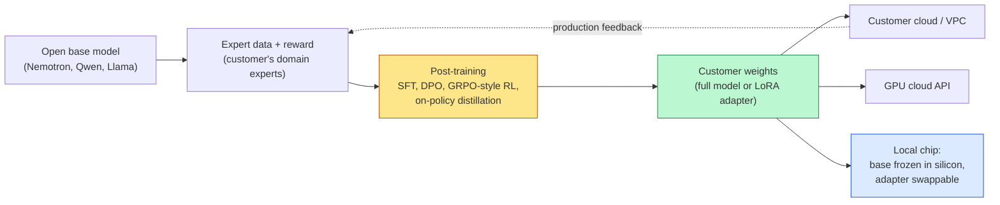
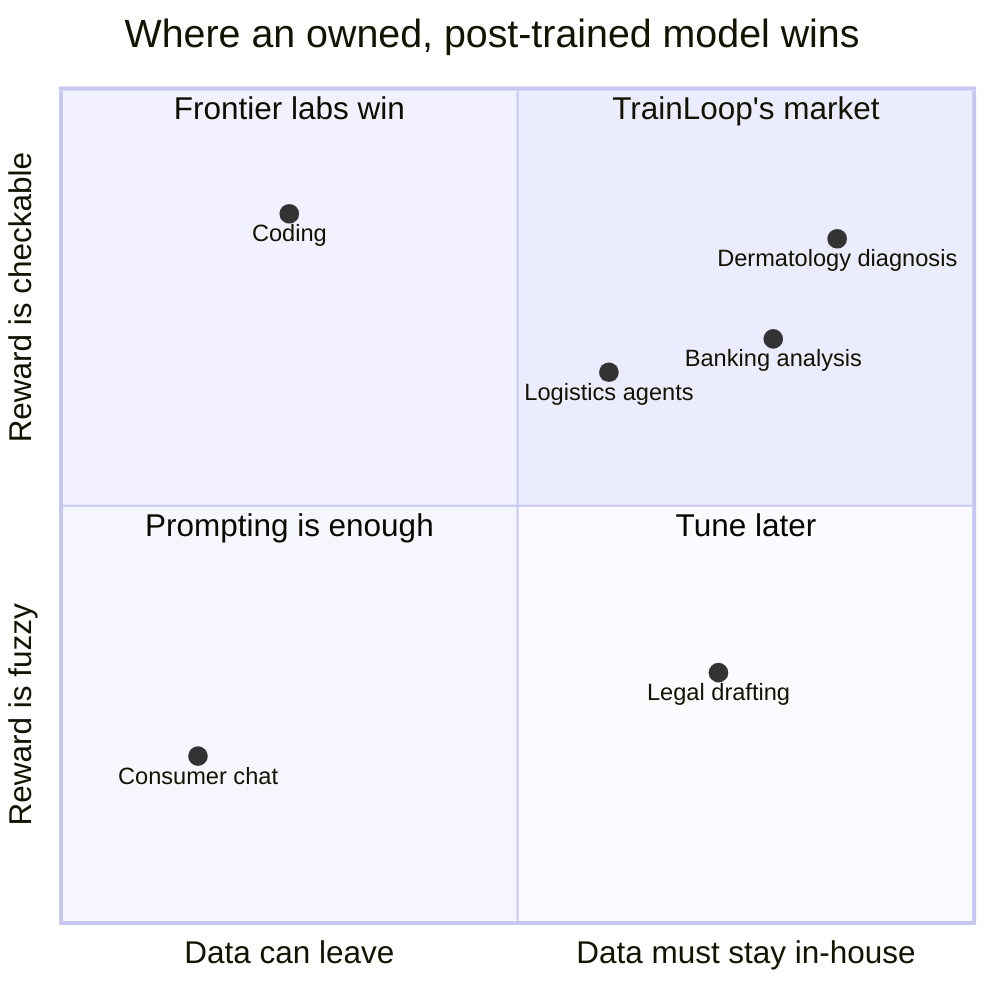

# TrainLoop: a strong engineer, a pivot to services, and a survival question that isn't about chips

**TrainLoop is a YC W25 post-training lab. It started as a three-line developer SDK and is now a forward-deployed team that trains custom models for biopharma, banking and logistics. The founder signal is real but narrower than "ex-AlphaFold" suggests. Traction is early: one public partner result and no disclosed revenue. Local inference is not the threat. Post-training produces weights, and weights run anywhere, including on a chip. The real threat is frontier labs and GPU clouds selling post-training as a self-serve feature. CoreWeave buying OpenPipe in 2025 shows both that threat and the likely exit: an acqui-hire is the floor and a product is the upside. Get the round terms first. The floor only protects a low entry price.**

## Five facts

1. **Raised about $500K.** Aggregators put it at roughly $500K in early 2025 from YC and Pioneer Fund, consistent with the standard YC deal. No priced round is public ([Tracxn](https://tracxn.com/d/companies/trainloop/__YMaFpIi_ijl13__7P4C0oH50ff4PS5YQZyUVGr7s9e4), [Preqin](https://www.preqin.com/data/profile/asset/trainloop/739036)).
2. **The pitch changed.** At YC the product was an SDK that "gathers training signals from actual usage," a reward model, and auto-deployed inference ([YC profile](https://www.ycombinator.com/companies/trainloop)). The site now says "We train expert models for long horizon tasks," using a research team and "a deployment team" that works with domain experts ([trainloop.ai](https://www.trainloop.ai/)).
3. **The open-source SDK went quiet.** The `sdk` repo was last pushed in April 2025 and `evals` (62 stars) in July 2025 ([GitHub](https://github.com/TrainLoop)).
4. **One public proof point.** On October 15, 2026, NVIDIA wrote that TrainLoop "post-trained" Nemotron 3.5 Super VL on dermatology data from Nolla ([NVIDIA](https://blogs.nvidia.com/blog/nemotron-3-5-super-vl/)). Nine days earlier, Utah let Nolla Health's app issue initial acne prescriptions in a 12-month regulatory sandbox, with physician oversight ([Utah Business](https://www.utahbusiness.com/industry/2026/10/06/utah-becomes-first-state-to-authorize-ai-to-issue-initial-prescriptions/)). NVIDIA gives no performance numbers.
5. **Six people, hiring a Head of Enterprise.** YC lists six employees and open roles for a Head of Enterprise and research staff ([YC jobs](https://www.ycombinator.com/companies/trainloop/jobs)). Hiring enterprise sales before a second public customer confirms the move to services.

## What TrainLoop sells

*Every deployment target, local included, runs post-training's output. On a hardwired chip it is the only part that can change.*

The techniques are public. DeepSeek showed that RL with verifiable rewards (GRPO) produces reasoning behavior ([DeepSeek-R1](https://arxiv.org/abs/2501.12948)). Thinking Machines showed that LoRA matches full fine-tuning for RL even at small ranks ([LoRA Without Regret](https://thinkingmachines.ai/blog/lora/)). The moat is the expert data, the reward design and the eval.

The wedge is delivery. The customer gets an open base model, weights assigned to it, deployment in its own VPC, and a team that sits with its clinicians or bankers. Self-serve platforms offer the first three. They don't offer the team. The buyer's alternatives are a frontier API with prompting, or hiring two ML engineers at roughly $600K a year fully loaded (my estimate). TrainLoop's price has to land below that and above its own GPU cost.

## Your three lenses

### 1. Traction: biopharma first makes sense, but sales are slow

*Author's judgment, not data: regulated work with checkable answers sits top right.*

Biopharma and banking are where owning a model matters most. Patient images and deal books can't leave the building. A diagnosis can be confirmed and a reconciliation audited, which gives RL a reward to train on. When one error is a misdiagnosis or a mispriced trade, a few points of accuracy pay for the work. Coding is bigger, but the frontier labs already own it.

Your concern holds in one way: sales cycles. Regulated buyers move slowly, which probably explains the thin record 18 months after YC (my inference). The site lists three partners (NollaMD, Mercor, Pathos). There is one public result, no revenue figure and no disclosed renewal.

### 2. Founder pedigree: check what "Gemini and AlphaFold" means

YC says Jackson Stokes worked on "Google Gemini and AlphaFold **performance**" ([YC](https://www.ycombinator.com/companies/trainloop)). That reads as systems and accelerator optimization, and the company's `jax2torch` repo fits. It matters, because post-training margins depend on GPU efficiency. It is not research leadership in RL or biology. YC's bio says CTO Mason Pierce led engineering at Second (YC W23), where he "hit the limits of off-the-shelf models." Nothing beyond YC confirms either bio. Call references and ask Stokes which systems he owned end to end.

### 3. Durability: local inference is the wrong threat

Fine-tuning is one part of post-training. Post-training also covers preference tuning, RL and distillation. Local inference changes where a model runs, not whether it needs tuning. It may raise demand: a 0.6B or 8B model needs post-training to compete, and TrainLoop forked the code of a step-wise distillation paper aimed at that case ([SOD, arXiv 2605.07725](https://arxiv.org/abs/2605.07725)). Taalas's HC1 hardwires Llama 3.1 8B into silicon and reportedly still accepts LoRA adapters ([Kaitchup](https://kaitchup.substack.com/p/taalas-hc1-absurdly-fast-per-user)). Apple customizes its on-device model the same way ([Apple](https://developer.apple.com/apple-intelligence/foundation-models-adapter)).

The real threats are elsewhere:

- **Platforms.** OpenAI sells reinforcement fine-tuning off the shelf ([docs](https://platform.openai.com/docs/guides/reinforcement-fine-tuning)). Thinking Machines' Tinker runs RL and lets teams download the weights ([Tinker docs](https://tinker-docs.thinkingmachines.ai/)). OpenPipe raised a $6.7M seed in 2024 ([VC News Daily](https://vcnewsdaily.com/openpipe/venture-capital-funding/cxjyjdmqhh)), and CoreWeave bought it in September 2025 on undisclosed terms ([CoreWeave](https://investors.coreweave.com/news/news-details/2025/CoreWeave-to-Acquire-OpenPipe-Leader-in-Reinforcement-Learning/default.aspx)). That deal is the clearest public signal of what a small RL team is worth to a GPU cloud.
- **Services gravity.** A six-person team can run two or three deployments at once. Revenue grows with headcount until the second deployment reuses the first one's data pipeline, reward models and evals.

## What to ask

| Question | Good answer | Red flag |
| --- | --- | --- |
| Round size and valuation | Priced near what an acqui-hire would pay | Priced as if the product already exists |
| Paid contracts vs. pilots, and contract size | Two or more paid six-figure contracts, one renewal | All pilots, or paid only in compute credits |
| Nolla result | A measured gain vs. the base model and a frontier API | "State of the art" with no number |
| What carries over to customer two | Shared reward and eval tooling, faster second deployment | Each engagement starts from zero |
| Who owns what | Weights assigned to the customer; TrainLoop keeps rights to its reward and eval tooling | Unclear IP terms, or TrainLoop keeps nothing reusable |
| Why the SDK stopped | A deliberate move to where the money is | Developers didn't adopt it |
| Gross margin | Above 60% at steady state | Engineers are the product |

## My read

Back it if Nolla's number is real, a second regulated customer has paid, and the second deployment took half the time of the first. Pass if every contract is bespoke. In that case compute efficiency only makes TrainLoop a cheaper consultancy, and a cloud or frontier lab ships the product.

<footer>Sources linked inline. Funding figures come from aggregators, not a company announcement. Founder bios come from YC only. Taalas adapter details come from secondary reviews. Written October 23, 2026.</footer>
