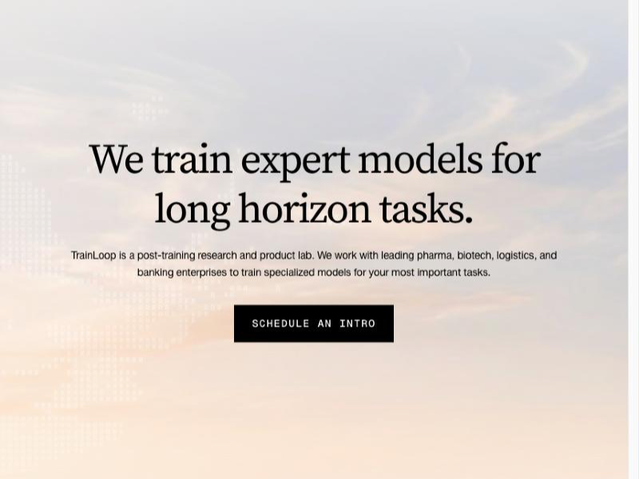
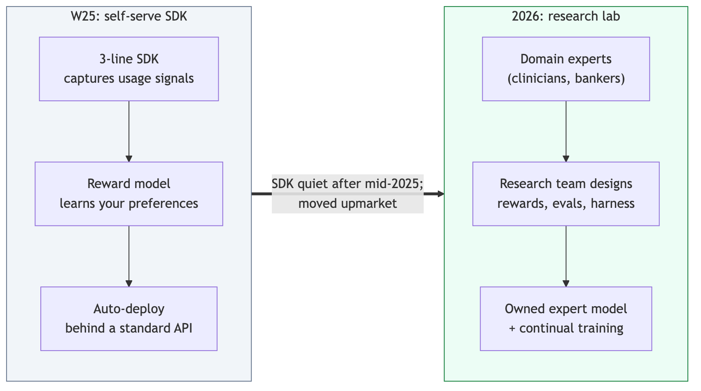
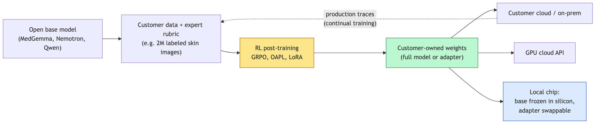
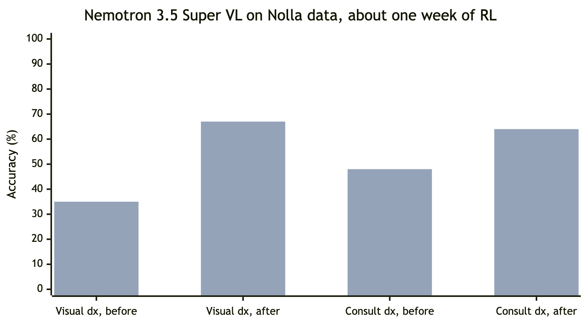
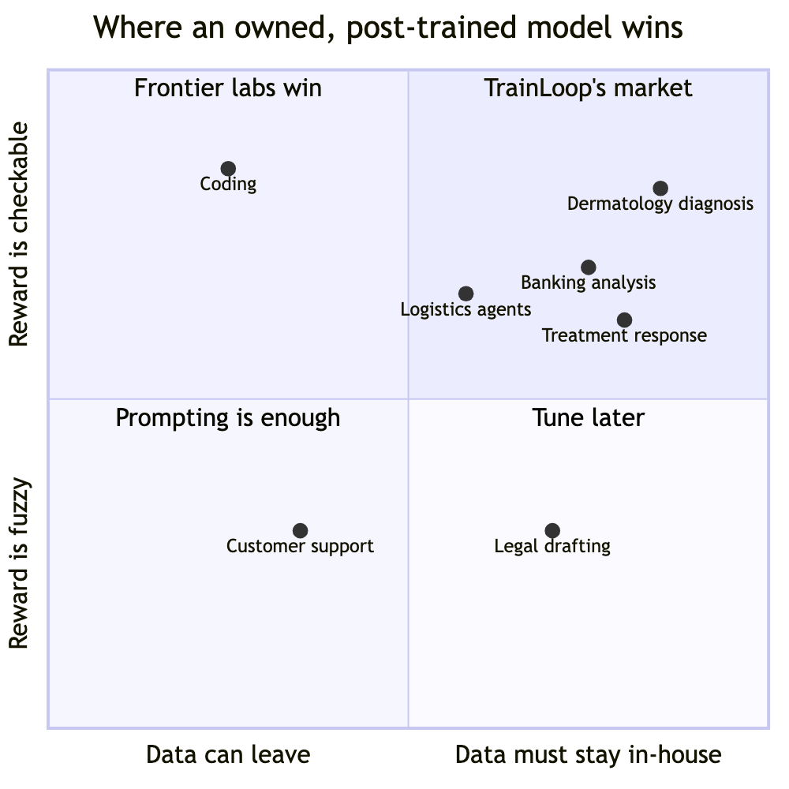
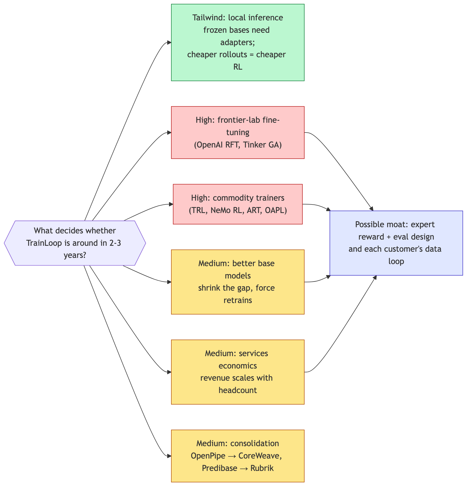

# TrainLoop AI: diligence memo

*Oct 23, 2026. This memo runs TrainLoop (YC W25), a post-training lab for biopharma, logistics, and finance, through three lenses: traction, founder pedigree, and durability. It ends with questions for the founders and an open-ended look at why someone would work there, and why they wouldn't.*

## Summary

- **Traction (promising, unproven):** Public results with Nolla Health, Mercor, and NVIDIA (early model access), plus a clinical post labeled Pathos. No revenue, contract, or paid-customer numbers are public.
- **Bio-first market (smart):** A smart wedge thanks to proprietary data, regulation, a strong need to own the model, and buyers who pay a lot. The risk is that it turns into custom research work.
- **Founders (solid, not elite):** The CEO was a Google software engineer from 2022 to 2024 on Gemini and XLA performance. The CTO was a founding engineer at Second (YC W23). They're a strong builder pair, but not senior research leaders.
- **Durability (main risk):** Local inference makes post-training more useful, not less. The real threats are frontier-lab fine-tuning, commodity training tools, and the economics of services work.
- **Funding (very early):** The only public figure is about $500K (Mar 2025, YC plus angels). No priced seed round was found.

> **Bottom line:** The research is real and the bio wedge makes sense. The open question is whether this becomes a product company or stays a very good research boutique. The last section lays out why someone would work there, and why they might not.

## Company snapshot

*The homepage pitch as of October 2026. Source: [trainloop.ai](https://www.trainloop.ai/).*

- **YC batch:** Winter 2025. Primary partner: David Lieb.
- **Founded and HQ:** 2025, North Beach, San Francisco.
- **Team size:** 6 on the YC profile. LinkedIn data shows 1 to 10 people.
- **Founders:** Jackson Stokes (CEO) and Mason Pierce (CTO). They were roommates before founding the company.
- **YC tagline:** "Reasoning fine-tuning: making it effortless for developers to improve LLMs through reinforcement learning."
- **Current site:** A post-training research and product lab that trains expert models for long-horizon tasks.
- **Website:** [trainloop.ai](https://www.trainloop.ai)
- **Disclosed funding:** $500K seed, Mar 2025 (YC, angel Aniq Kassam). Pioneer Fund and Marble Creek Ventures are also listed as investors. LinkedIn data says $625K in total. These are unaudited aggregator figures.

## What they actually sell

The pitch has shifted, and the shift matters. Their W25 Launch YC post sold a self-serve developer platform: a three-line SDK that captures signals from real usage, a reward model trained on your preferences, then automatic deployment behind a standard API. The 2026 site sells something else: a research lab with a deployment team that works alongside a customer's experts to train proprietary models.

*The pivot. The open-source SDK repo was last pushed in April 2025 ([GitHub](https://github.com/TrainLoop)).*

- **Methods:** RL post-training (GRPO, OAPL), LoRA adapters, rubric-based reward models graded by an LLM judge, and agent harness design.
- **Model areas:** biological reasoning models for pharma and biotech, reliable agents for finance and logistics, and multimodal document and image reasoning.
- **Research areas:** life sciences, continual training, information theory, and evaluation and interpretability.
- **Open source:** an LLM evals framework (TrainLoop Evals). On GitHub, the CEO forks agent benchmarks and RL tools such as Harbor, APEX-Agents, and SDPO.

*Post-training produces weights that can run anywhere. On a hardwired local chip the adapter is the only part that can change, and production traces feed the next round of training.*

My read is that the self-serve product probably didn't stick against free tools and lab APIs, so they moved upmarket into high-touch enterprise work. That's a sensible move for a small team, but it changes the business model: higher contract values, lower margins, and slower growth.

## Lens 1: Traction

*TrainLoop's research page is where the traction evidence lives. Source: [trainloop.ai/research](https://www.trainloop.ai/research).*

- **Nolla Health (Apr 2026):** NollaMD, MedGemma 27B post-trained with GRPO on about 2M dermatology and visual-medicine images. Reported state of the art on their holdout set at about 1/30th the cost of frontier models ([post](https://www.trainloop.ai/research/nollamd)).
- **Pathos, as labeled on the post (Apr 2026):** A clinical treatment-response prediction task on Qwen 3.5 27B. One OAPL update took the model from unusable to 48% correct. The post itself says the eval set is small ([post](https://www.trainloop.ai/research/oapl)).
- **Mercor (May 2026):** Rebuilt knowledge-work agents as coding agents on APEX-Agents (banking, law, consulting). Reported 25% better and a new SOTA. A production logistics agent saw 80% fewer failures and 40% lower cost per task ([post](https://www.trainloop.ai/research/mercor)).
- **NVIDIA and Nolla (Oct 2026):** Early access to Nemotron 3.5 Super VL. Visual accuracy rose from 35% to 67% in about a week, and consultation diagnosis accuracy from 48% to 64% ([post](https://www.trainloop.ai/research/nvidia)).

*Company-reported results: 500-question visual eval and 75 held-out consultations, trained on 32 B200 GPUs. Source: [TrainLoop](https://www.trainloop.ai/research/nvidia).*

These are real technical results, and NVIDIA's early model access plus Mercor's co-branded post are good signals. But Nolla appears in two of the five posts, and none of them includes contract size, revenue, or renewals. The site says "leading pharma, biotech, logistics, and banking enterprises" but names no big pharma or bank. Treat "enterprise pilots" as unverified until they show signed paid contracts.

### Is biopharma a strange first market?

I think it's a smart one, with one catch. Post-training is worth paying for when four things are true: the customer has unique labeled data, the model has to be owned and auditable, the task is narrow enough for a small model to beat a frontier model, and the buyer pays a lot per decision. Biopharma and clinical work meet all four. Nolla's roughly 2M labeled images are exactly the kind of data moat a general model can't copy. Finance shares the regulation and the data-residency pull, which explains why it's the second market.

*Author's judgment, not data. Regulated work with checkable answers sits top right, which is where TrainLoop's customers are.*

**Pros**

- Data that can't leave the building is a natural reason to own the model.
- Benchmarks are easy to verify, such as diagnosis accuracy and survival prediction.
- High willingness to pay, and a long tail of biotechs with no ML team.
- A 1/30th cost advantage is easy to sell at production volume.

**Cons**

- Long sales cycles and regulatory gates at big pharma.
- Biotech customers depend on funding cycles and churn.
- Each engagement is bespoke, so it trends toward consulting.
- Early customers are startups (Nolla), not the pharma logos the site implies.

You named other lucrative markets. Coding, legal, and customer support are bigger, but frontier labs and well-funded vertical startups already serve them well, so a 6-person team would get squeezed. Bio is defensible exactly because it's awkward.

## Lens 2: Founder pedigree

- **Jackson Stokes, CEO:** Google software engineer, Jan 2022 to Jan 2024, on Gemini, XLA, and Research ([LinkedIn](https://linkedin.com/in/jacksonstokes)). His YC bio says "Gemini & AlphaFold performance." Before that he was a CV and NLP research assistant (2020 to 2022) and a Google Research intern (2021). His [GitHub](https://github.com/jvstokes) calls him a former Google Research, XLA, and Gemini performance engineer.
- **Mason Pierce, CTO:** Founding engineer and engineering lead at Second (YC W23), which built AI agents for codebase maintenance (joined about Mar 2024). Before that he was at Camio and studied at UC Santa Cruz. His YC bio says he always found fine-tuning harder than it should be.
- **Research staff:** Logan Grasby is the lead author on the clinical posts. Joan Cabezas co-wrote the Mercor post. Mercor's Bertie Vidgen and clinicians from Nolla are listed as co-authors.

The claim checks out, but it's narrower than "from Gemini and AlphaFold" sounds. He spent two years as a mid-level engineer on performance and compiler work (XLA), making models run fast. He wasn't a research scientist designing post-training recipes, and I couldn't find any public papers from either founder. Nothing beyond his own bio describes his AlphaFold work. There's also an unexplained gap between leaving Google (Jan 2024) and founding TrainLoop (Jan 2025).

On your Google-alumni prior: the "Google is 4th or 5th" framing matters less here. Gemini infrastructure experience is still among the best training grounds for large-scale training systems, and performance engineering transfers directly to cheap, fast RL runs. The better test is output since founding, and that looks good. They've published five technical posts in about six months, with honest caveats (for example, "one task and one seed") and co-authors from real partners. That reads as builders who ship, not people still figuring things out.

**Concerns**

- No senior RL researcher or ex-lab post-training lead among the founders.
- No industry operator from pharma or finance, which matters for enterprise sales.
- A young team selling into the most demanding buyers in regulated industries.

## Lens 3: Durability

Your suspicion is right: local inference and post-training work together, they don't compete. The evidence points that way.

- Taalas's HC1 chip hardwires Llama 3.1 8B into silicon, but it still supports LoRA fine-tuning ([Taalas](https://taalas.com/the-path-to-ubiquitous-ai/)). Frozen base weights make adapters the only way to customize the model.
- Apple's on-device model is customized through LoRA adapters, and each adapter fits only one system model version ([Apple](https://developer.apple.com/apple-intelligence/foundation-models-adapter/)). That means retraining every time the base model changes.
- Small local models are where specialization pays off most. TrainLoop's whole pitch is a 27B model beating frontier models on one task at about 1/30th the cost.
- Cheaper inference makes RL cheaper too, because rollouts are most of the compute in RL training.

So a world with more on-device and on-prem models needs more post-training, not less. The real durability risks are elsewhere.

*Risk levels are my judgment. The possible moat is what's left once the trainer itself is free.*

- **Frontier labs' fine-tuning (high):** OpenAI offers reinforcement fine-tuning ([OpenAI](https://community.openai.com/t/fine-tuning-updates-reinforcement-fine-tuning-now-available-gpt-4-1-nano-fine-tuning/1255539)), and Thinking Machines' Tinker is generally available ([Tinker](https://thinkingmachines.ai/news/tinker-general-availability/)). The labs sell the trainer as a commodity.
- **Commodity tooling (high):** Open-source RL libraries (TRL, NeMo RL, OpenPipe ART) and new algorithms like OAPL are public, so the trainer itself is not a moat.
- **Base models improve (medium):** Each new frontier release shrinks the gap a fine-tune closes. It also forces retraining, which is recurring revenue but also a treadmill.
- **Services economics (medium):** A forward-deployed research model scales with headcount, and margins look like consulting.
- **Consolidation (medium):** Predibase went to Rubrik ([TechCrunch](https://techcrunch.com/2025/06/25/rubrik-acquires-predibase-to-accelerate-adoption-of-ai-agents/)) and OpenPipe went to CoreWeave ([CoreWeave](https://www.coreweave.com/news/coreweave-to-acquire-openpipe-leader-in-reinforcement-learning)). That gives an exit path, but also suggests standalone fine-tuning companies struggle.

If TrainLoop lasts, its moat will be reward and eval design built with domain experts, plus the data loop with each customer. It won't be the training code. A good sign for the 2 to 3 year horizon is their focus on continual training, meaning learning from production traces offline (the OAPL post). That points toward ongoing, recurring contracts rather than one-off projects.

## Competitive landscape

- **OpenAI RFT (frontier lab API):** Reinforcement fine-tuning on closed models. The customer doesn't own the weights.
- **Thinking Machines Tinker (training API):** Generally available API for fine-tuning open-weight models. The closest threat to the original self-serve pitch.
- **Adaptive ML (enterprise RL platform):** $20M seed in 2024 ([Adaptive](https://www.adaptive-ml.com/post/adaptive-raises-seed)). The same "own your model" enterprise RL pitch, with a larger team.
- **OpenPipe, now CoreWeave (RL for agents):** Acquired in Sep 2025. ART is still open source.
- **Predibase, now Rubrik (fine-tuning and serving):** Acquired in 2025 for enterprise agent work.
- **Together and Fireworks (inference clouds):** Bundle fine-tuning with serving, competing on price.

TrainLoop sets itself apart as a research partner for domain-heavy, multimodal, long-horizon tasks, not as a tool. That's a real gap, but it's also where services firms and the labs' own forward-deployed teams compete.

## Questions for the founders

1. How many paying customers do you have, what is the average contract value, and how much of revenue comes from Nolla?
2. Are the pharma and banking work paid production contracts or unpaid pilots? Can we talk to one reference customer?
3. What did you learn from the self-serve SDK, and why did you move to a lab model?
4. What do you keep after each engagement (reward models, eval suites, environments) that makes the next customer cheaper to serve?
5. What does gross margin look like, and how many researchers does each new customer need?
6. Who owns the weights and the training data? How do you handle HIPAA, data residency, and on-prem deployment?
7. When a customer can run OpenAI RFT or Tinker themselves, why do they pay you?
8. How are you raising now, and what milestones will the round fund?
9. Jackson: what exactly did you do on AlphaFold and Gemini performance, and what did you do in 2024?

## Bottom line: why work there, and why not

This section doesn't pick an answer. It sets out the case each way so the reader can weigh it against what they want from their next few years.

**Why someone would work there**

- **Frontier post-training, hands on.** The team ran RL on 32 B200 GPUs and moved a new NVIDIA model from 35% to 67% in about a week ([post](https://www.trainloop.ai/research/nvidia)). Few places let a small team do that work and publish it.
- **Your name on the work.** Posts credit individual researchers and partner co-authors. With six people, everyone's work shows.
- **Work that touches patients.** Their model training sits behind Nolla, the first company Utah allowed to have AI write initial prescriptions.
- **Breadth.** One job spans biology, finance, logistics, multimodal reasoning, reward design, evals, agent harnesses and serving cost.
- **Early equity.** YC lists early roles at $150K to $250K with 0.5% to 1.5% equity ([YC jobs](https://www.ycombinator.com/companies/trainloop/jobs)).
- **A team that ships.** Five technical posts in about six months, with honest caveats.

**Why someone might not**

- **The business model isn't settled.** If it stays a boutique, the job is closer to forward-deployed consulting: one customer's data and deadlines at a time.
- **Thin public funding.** About $500K is the only disclosed figure. Runway and the next round are unknown.
- **Customer concentration.** Nolla appears in two of five posts. Losing one partner would matter.
- **No senior research mentor.** Neither founder is a veteran post-training researcher. You'd learn by doing, not by apprenticing.
- **The trainer is being commoditized.** OpenAI RFT and Tinker sell what TrainLoop builds. A likely outcome is an acquisition like OpenPipe's, which keeps the team together but may cap what equity is worth.
- **Slow buyers.** Regulated customers mean long cycles and compliance work between the interesting parts.

**Questions to answer for yourself**

- Would you rather learn post-training at the frontier with a small team, or join a company whose business model is already proven?
- How much of your week are you willing to spend inside one customer's workflow?
- If the company were acquired in two years, would the skills and network be worth it even if the equity wasn't?
- What would the founders tell you about runway, revenue mix, and who you'd learn from? Ask them.

## Sources

- [TrainLoop YC company profile](https://www.ycombinator.com/companies/trainloop)
- [Launch YC: Unlock next-level reasoning through fine-tuning](https://www.ycombinator.com/launches/Msf-trainloop-unlock-next-level-reasoning-through-fine-tuning)
- [TrainLoop homepage](https://www.trainloop.ai/)
- [TrainLoop research index](https://www.trainloop.ai/research)
- [Introducing NollaMD (Apr 9, 2026)](https://www.trainloop.ai/research/nollamd)
- [Can we train a model in one step? OAPL (Apr 28, 2026)](https://www.trainloop.ai/research/oapl)
- [Your knowledge work agent should be a coding agent (May 12, 2026)](https://www.trainloop.ai/research/mercor)
- [From last place to the frontier in a week (NVIDIA + Nolla)](https://www.trainloop.ai/research/nvidia)
- [Training NVIDIA Nemotron for clinical care (Nolla Health)](https://www.nollahealth.com/blog/nollamd-nvidia-nemotron)
- [TrainLoop $500K seed (Startup Intros)](https://startupintros.com/news/2025-03-01-trainloop-seed)
- [TrainLoop seed round investors (Seedtable)](https://seedtable.com/companies/trainloop/funding-rounds/seed-2025-01)
- [Why we invested in TrainLoop (Marble Creek Ventures, Mar 26, 2025)](https://www.marblecreekventures.com/notes/why-we-invested-in-trainloop)
- [TrainLoop YC jobs](https://www.ycombinator.com/companies/trainloop/jobs)
- [Jackson Stokes on LinkedIn](https://linkedin.com/in/jacksonstokes)
- [jvstokes on GitHub](https://github.com/jvstokes)
- [Mason Pierce profile (Fundraising Fox)](https://fundraisingfox.com/people/mason-pierce)
- [Founder story video (Rippling)](https://www.youtube.com/watch?v=WHf1WQa6loo)
- [Taalas: the path to ubiquitous AI (HC1)](https://taalas.com/the-path-to-ubiquitous-ai/)
- [Apple Foundation Models adapter training](https://developer.apple.com/apple-intelligence/foundation-models-adapter/)
- [Tinker general availability](https://thinkingmachines.ai/news/tinker-general-availability/)
- [OpenAI reinforcement fine-tuning availability](https://community.openai.com/t/fine-tuning-updates-reinforcement-fine-tuning-now-available-gpt-4-1-nano-fine-tuning/1255539)
- [CoreWeave to acquire OpenPipe](https://www.coreweave.com/news/coreweave-to-acquire-openpipe-leader-in-reinforcement-learning)
- [Rubrik acquires Predibase (TechCrunch)](https://techcrunch.com/2025/06/25/rubrik-acquires-predibase-to-accelerate-adoption-of-ai-agents/)
- [Adaptive raises $20M seed](https://www.adaptive-ml.com/post/adaptive-raises-seed)

<footer>Mirrors the Notion version of this memo. Diagrams are Mermaid sources in assets/trainloop/*.mmd, rendered with mermaid-cli. Results are company-reported. Funding figures come from aggregators.</footer>
